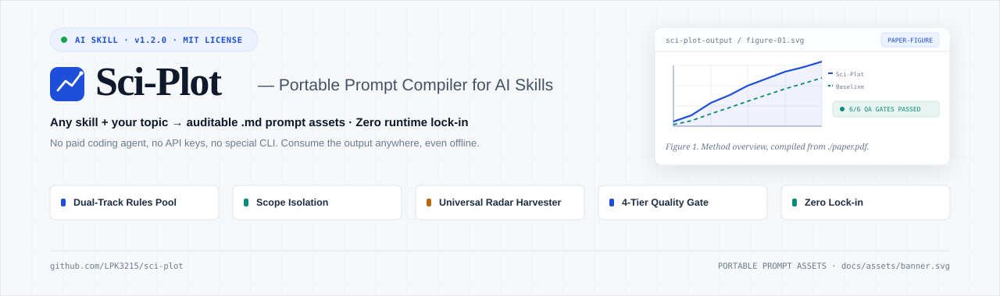
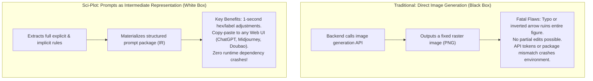
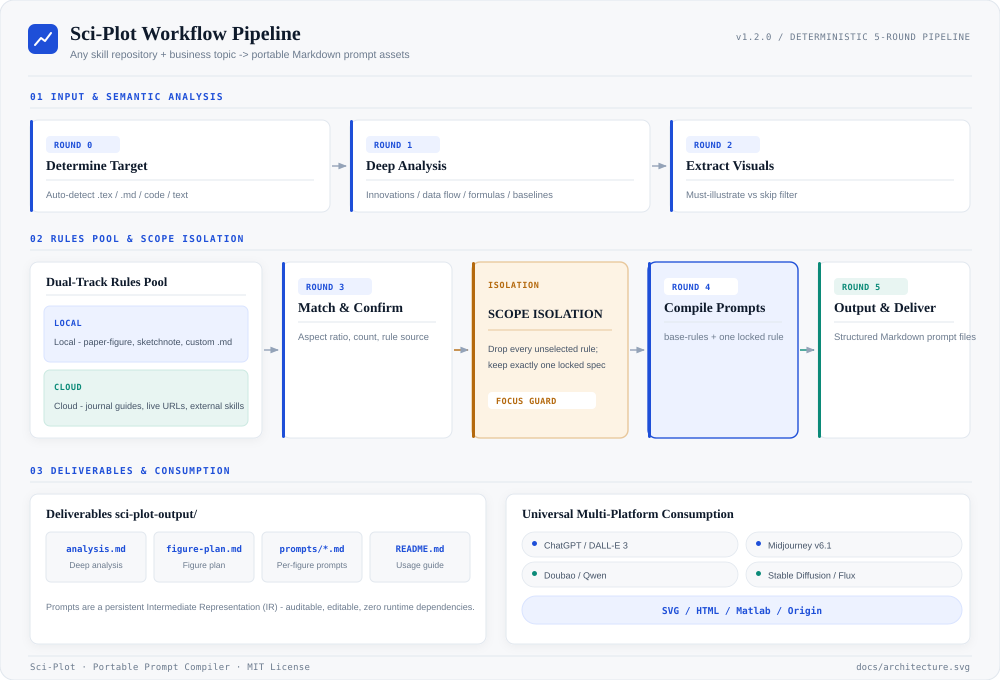
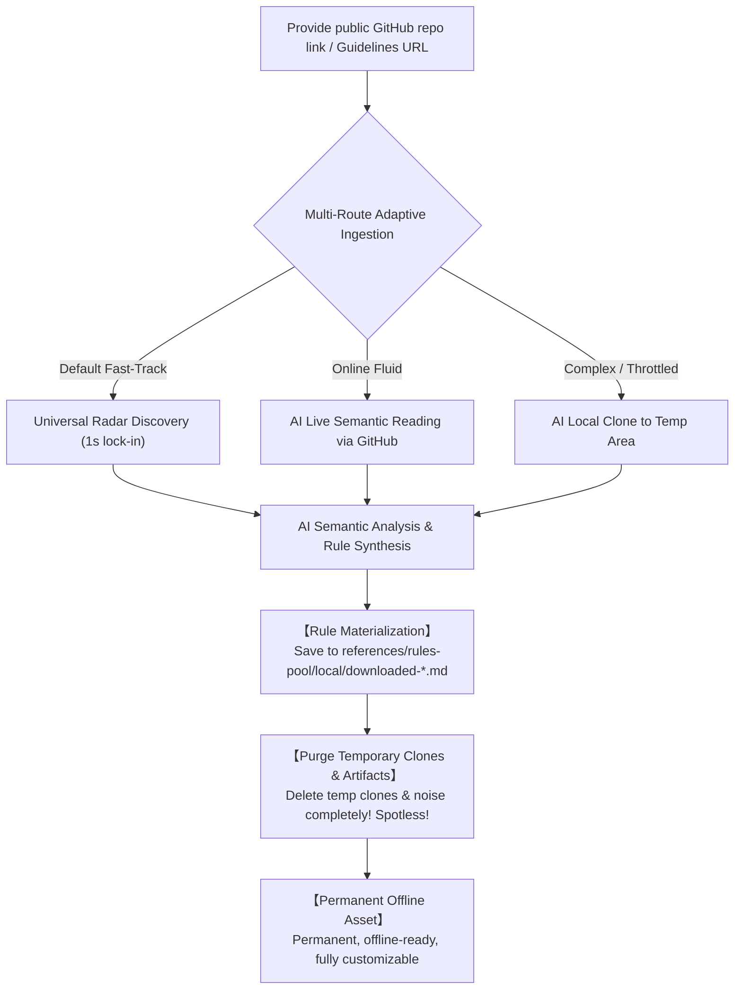
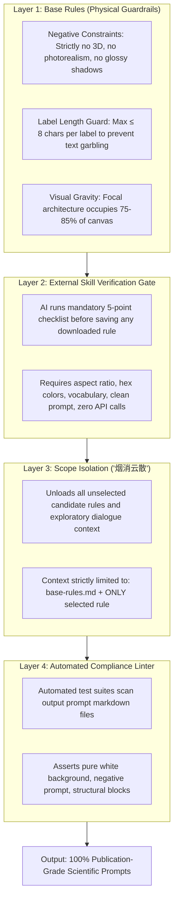
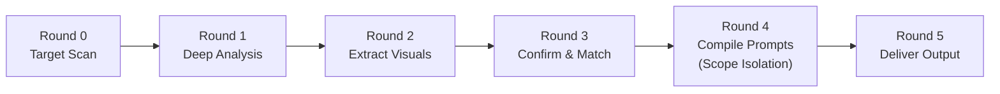

<div align="center">



# Sci-Plot

[](CHANGELOG.md)
[](LICENSE)
[](pyproject.toml)
[](SKILL.md)
[](tests/run_all_tests.py)
[](requirements.txt)

**Scientific illustration, from paper to figure — an all-in-one prompt engine.**

Sci-Plot does not generate images directly; it produces publication-ready, cross-platform prompts.  
Copy prompts into **ChatGPT/DALL-E, Doubao, Qwen, Midjourney, Stable Diffusion** to generate images,  
or use them as specifications to generate **HTML, SVG, Matplotlib, or Origin** academic figures.

**Compatible with any AI coding assistant** — Claude Code, Codex, Cursor, Windsurf, GitHub Copilot, Cline, Antigravity, or any agent capable of reading skill definitions.

[Features](#-core-features) · [Architecture](#-visual-architecture-diagram) · [Workflow](#-5-round-standardized-pipeline) · [Quick Start](#-quick-start) · [FAQ](FAQ.md) · [🌐 Project Overview](https://lpk3215.github.io/sci-plot/)

[中文说明文档](README.zh-CN.md)

</div>

---

## 📌 Project Overview

- **Repository**: [https://github.com/LPK3215/sci-plot](https://github.com/LPK3215/sci-plot)
- **Live Project Overview Dashboard**: [https://lpk3215.github.io/sci-plot/](https://lpk3215.github.io/sci-plot/)
- **Core Philosophy**: **"Prompts as Intermediate Representation (IR), Never Direct Bitmaps"**

Many scientific illustration tools call image generation APIs directly inside agent environments. This creates three fatal engineering bottlenecks:
1. **Environment Fragility & Crashes**: Direct API callers tightly couple to local runtime tools, Python packages, and API keys. Any network blockage or credential issue crashes the agent. Sci-Plot has **zero external runtime dependencies**.
2. **Black-box Output**: A single typo or inverted arrow ruins an entire raster bitmap (PNG/JPEG) with no way to perform surgical edits.
3. **No Asset Persistence**: Raster images cannot be easily audited, versioned, or tracked in Git repositories.



---

## 🖼️ Visual Architecture Diagram

The end-to-end workflow and dual-track rule isolation pipeline is illustrated below:



> *Figure 1: Sci-Plot Workflow Architecture (v1.2.0) — From input detection to dual-track rule matching, scope isolation, and multi-platform consumption.*

> [!TIP]
> **Explore Live Interactive Architecture Diagrams (Powered by Archify)**:
> - ⚡ **[Interactive Core Architecture (10-Min Fast-Track)](./docs/archify/core-architecture.html)** — Focus on the primary 5-round pipeline
> - 🏛️ **[System Panorama Architecture](./docs/archify/architecture-panorama.html)** — Comprehensive 12-component landscape
> - 🔄 **[Workflow Execution Pipeline](./docs/archify/workflow-panorama.html)** — End-to-end execution path with lane separation
> - ⏱️ **[Invocation Sequence Call Chain](./docs/archify/sequence-panorama.html)** — Exact call trace across boundaries
> - 🌊 **[Data Flow & Storage Pipeline](./docs/archify/dataflow-panorama.html)** — Transformation from raw paper to verified prompts
> - 📊 **[Interactive Project Overview Dashboard](./docs/project_overview/index.html)** — Full panoramic showcase & quickstart
> - 📸 **[Shareable Project Card (PNG Export)](./docs/project_overview/project_card.html)** — Compact summary card with 1-click PNG export
> - 📄 **[Architecture Blueprint Input (diagram-input.md)](./docs/archify/diagram-input.md)** — Structured input specifications

---

## ✨ Core Features

### 1. Dual-Track Rules Pool
- **Local Rules Pool (`references/rules-pool/local/`)**: Houses core, battle-tested presets (`paper-figure`, `journal-minimal`, `sketchnote`, `warm-notes`, `business-research`). Users can drop custom `.md` rules here for immediate zero-config use.
- **Cloud & External Rules Pool (`references/rules-pool/cloud/`)**:
  - **Authoritative Journal Standards**: Official guidelines for Nature, IEEE, Cell, Science;
  - **Dynamic URL Parser**: Pass any URL containing figure guidelines; the agent extracts dimensions, colors, and constraints on the fly;
  - **External Skill Capability Harvester**: When an external image generation skill is available, **extract its prompt engineering templates and domain vocabulary, while strictly blocking its image generation API calls**. Zero environment overhead, 100% capability reuse.

### 2. Scope Isolation ("烟消云散")
During exploratory rounds, the agent can recommend and search across pools. **Once you confirm a specific rule, all unselected rules, candidate links, and exploratory noise are completely cleared from the active prompt context.**
The final prompt compilation step loads strictly:
$$\text{Base Physical Guardrails (base-rules.md)} + \text{Sole Selected Rule}$$
This eliminates hallucinated rule conflicts (e.g., mixing Nature minimal palettes with IEEE bold borders).

### 3. Universal Skill Harvester (Heuristic Radar)
For external or public GitHub skill repositories, Sci-Plot dynamically discovers, extracts, and normalizes figure guidelines while keeping your workspace completely clean:



### 4. Four-Tier Quality Assurance Gate
Prompt precision is the lifeline of Sci-Plot. Four defensive layers ensure zero-defect output:



---

## 🛠️ Tech Stack

| Layer | Component | Implementation Details |
|---|---|---|
| **Skill Protocol** | Agent Skill Specification | Standard YAML frontmatter + 5-round deterministic pipeline (`SKILL.md`) |
| **Engine & Scripts** | Python 3.10+ | Pure Standard Library (`urllib.request`, `json`, `ssl`, `base64`, `re`, `pathlib`) — **Zero External Dependencies** |
| **Testing & Quality** | Python Automated Test Suite | `tests/run_all_tests.py`, pytest, ruff linter |
| **Visual Assets** | Hand-Crafted Vector SVG & HTML | Modern dark-themed dashboard (`docs/project_overview/`), architecture SVG, banner SVG |
| **Consumption Targets** | Cross-Platform Prompts & Code | ChatGPT/DALL-E, Midjourney, Stable Diffusion, Doubao, Qwen, HTML/SVG, Matplotlib, Origin |

---

## 📂 Project Structure

```
sci-plot/
├── SKILL.md                              # AI Skill: 5-round standardized pipeline & isolation
├── README.md                             # User documentation (English)
├── README.zh-CN.md                       # User documentation (Chinese)
├── LICENSE                               # MIT License
├── CHANGELOG.md                          # Version history (English)
├── CHANGELOG.zh-CN.md                    # Version history (Chinese)
├── CONTRIBUTING.md                       # Contribution guidelines (English)
├── CONTRIBUTING.zh-CN.md                 # Contribution guidelines (Chinese)
├── FAQ.md                                # Frequently Asked Questions (standalone reference)
├── AUTHORS                               # Authors and maintainers
├── pyproject.toml                        # PEP 621 package metadata and tool configuration
├── requirements.txt                      # Runtime & development dependency notes
├── docs/                                 # GitHub Pages root & documentation assets
│   ├── index.html                        # Pages root redirect
│   ├── .nojekyll                         # Disables Jekyll processing
│   ├── architecture.svg                  # English architecture SVG
│   ├── architecture_cn.svg               # Chinese architecture SVG
│   ├── assets/
│   │   └── banner.svg                    # Brand banner SVG
│   ├── archify/                          # Interactive Archify diagrams & blueprint
│   │   ├── diagram-input.md
│   │   ├── core-architecture.html
│   │   ├── architecture-panorama.html
│   │   ├── workflow-panorama.html
│   │   ├── sequence-panorama.html
│   │   └── dataflow-panorama.html
│   └── project_overview/                 # Interactive dashboard & shareable card
│       ├── index.html
│       ├── style.css
│       ├── script.js
│       └── project_card.html
├── scripts/                              # Skill management & harvesting tools
│   ├── universal_skill_harvester.py      # Heuristic radar scanner for external skills
│   ├── fetch_external_skills.py          # Top 3 skills fetcher
│   ├── sync_documentation_metrics.py     # Cross-document consistency & metrics auditor
│   └── visualization/                    # Visual assets generation scripts
│       └── generate_banner.py            # Banner generator script
├── tests/                                # Automated test suite (100% pass)
│   ├── run_all_tests.py                  # Test suite runner
│   ├── test_rules_pool_integrity.py
│   ├── test_prompt_compliance.py
│   ├── test_end_to_end_simulation.py
│   ├── test_cloud_downloader.py
│   ├── test_external_skills_ingestion.py
│   └── test_top10_radar_scan.py
└── references/                           # Scientific rules & references
    ├── core/                             # Foundational base rules
    │   └── base-rules.md                 # Physical guardrails (labels, colors, no-3D)
    ├── analysis-guide.md                 # Paper & code semantic analysis checklists
    ├── layout-rules.md                   # Multi-page figure roles & pacing
    ├── prompt-rules.md                   # Core prompt syntax & anti-patterns
    ├── rules-pool/                       # Dual-Track Rules Pool
    │   ├── local/                        # Local Pool (presets & materialized rules)
    │   └── cloud/                        # Cloud Pool (channels & adapter protocols)
    └── renderers/                        # Vector and HTML renderers
        └── html/                         # Academic static HTML figure template
```

---

## 🚀 Quick Start

### 1. Zero-Install Usage in AI Assistants
In any workspace containing sci-plot (Cursor, Claude Code, Windsurf, Copilot, Cline, Antigravity):

```text
Follow the /sci-plot/SKILL.md skill to generate scientific figure prompts.
Target: [optional — leave blank to auto-analyze project, or provide path / arXiv / text]
```

### 2. Running Automated Test Suite
To verify rules pool integrity, compliance checks, and radar scanner locally:

```bash
python tests/run_all_tests.py
```

All 6 test suites run using standard library with zero external dependencies.

---

## 🔄 5-Round Standardized Pipeline



### Inputs
- **Local Papers / Code**: Auto-detects `.tex` files (LaTeX source), `.md`, PDF, or Python code;
- **ArXiv Links / IDs**: e.g., `https://arxiv.org/abs/1706.03762` or `1706.03762`;
- **Pasted Text**: Directly paste abstracts, methods, or algorithm steps;
- **Custom Rule Specification**: Local `.md` path, online URL, or external skill name.

### Outputs
Standardized directory structure in `sci-plot-output/`:
```
sci-plot-output/
├── analysis.md             # Semantic breakdown (contributions, data flow, modules)
├── figure-plan.md          # Multi-figure plan (roles, pacing, composition)
├── prompts/
│   ├── 01-overview.md      # Page 1 prompt (English + Chinese)
│   ├── 02-mechanism.md     # Page 2 mechanism zoom-in prompt
│   └── ...
└── README.md               # Consumption instructions (paste to Web AI or compile to code)
```

### Consumption Options

| Target Platform | How to Use | Outcome |
| :--- | :--- | :--- |
| **ChatGPT / DALL-E (Recommended)** | Copy English Prompt directly into chat | High-res academic figure |
| **Doubao / Qwen** | Copy English or Chinese prompt directly | Fast conceptual drafts |
| **Midjourney** | `/imagine` + English Prompt | Stylized high-texture graphics |
| **Stable Diffusion / Flux** | Paste into txt2img positive prompt | Local reproducible rendering |
| **SVG / HTML / Matplotlib / Origin** | Pass module layouts and flow arrows to coding AI | Editable vector & interactive plots |

---

## ❓ Frequently Asked Questions (FAQ)

- **Q: Why prompts only, instead of calling image APIs directly?**  
  *A: Direct image generation introduces environment lock-in, uneditable bitmaps, and crashes. Prompts serve as reviewable, durable Intermediate Representations (IR).*
- **Q: What is Scope Isolation ("烟消云散")?**  
  *A: After confirming a rule in Round 3, all unselected rules and exploratory context are cleared out. Round 4 compiles prompts strictly against `base-rules.md` plus your sole chosen rule, eliminating hallucinated style conflicts.*
- **Q: How to add custom laboratory guidelines?**  
  *A: Add a `.md` file to `references/rules-pool/local/` (e.g., `my-lab-style.md`). The AI recognizes it dynamically without code modifications.*

👉 Read the full **[FAQ.md](FAQ.md)** for detailed explanations.

---

## 🤝 Contributing

Contributions are warmly welcomed! Please check out:
- **[CONTRIBUTING.md](CONTRIBUTING.md)** (English)
- **[CONTRIBUTING.zh-CN.md](CONTRIBUTING.zh-CN.md)** (中文贡献指南)

---

## 📜 License & Authors

- **License**: [MIT License](LICENSE) &copy; 2026 LPK3215
- **Authors**: LPK3215 (`17538703215@163.com`) — see [AUTHORS](AUTHORS)
- **Changelog**: See [CHANGELOG.md](CHANGELOG.md) for version evolution details.
