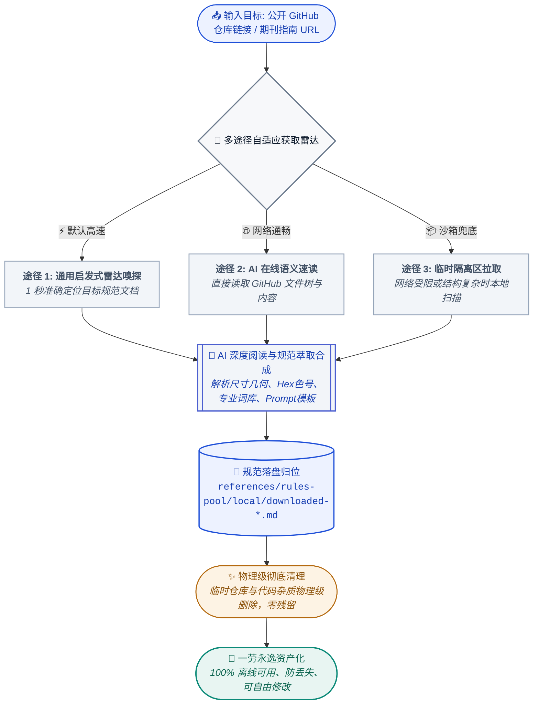

<div align="center">

<p align="center">
  
</p>

# Sci-Plot

[](CHANGELOG.zh-CN.md)
[](LICENSE)
[](pyproject.toml)
[](SKILL.md)
[](tests/run_all_tests.py)
[](requirements.txt)

**把任意 Skill 变成可移植的 Markdown 提示词资产——不买付费智能体，不绑运行环境。**

给它任意 Skill 仓库（GitHub 地址、本地目录或你自己的规范）加上一个业务主题。  
它把规范萃取为结构化的 **`.md` 提示词文件**——一份可审计的中间表示（IR）——  
然后你可以粘贴到 **ChatGPT、Claude、豆包、Midjourney**、本地脚本或任意渲染器里消费。

**零运行时依赖，零厂商锁定。** 产物是纯 Markdown，任何聊天客户端、任何编程智能体、甚至完全离线都能用——不需要 Codex 订阅、不需要 API Key、不需要特定 CLI。

仓库内置**科研绘图规范包**作为参考领域，编译器本身与领域无关。

[功能亮点](#-核心功能亮点) · [架构图](#-可视化架构全景) · [工作流](#-标准-5-轮工作流) · [快速上手](#-快速上手) · [常见问答](FAQ.md) · [🌐 在线全景观览](https://lpk3215.github.io/sci-plot/)

[English Documentation](README.md)

</div>

---

## 📌 项目总览

- **仓库地址**: [https://github.com/LPK3215/sci-plot](https://github.com/LPK3215/sci-plot)
- **在线全景观览看板**: [https://lpk3215.github.io/sci-plot/](https://lpk3215.github.io/sci-plot/)
- **核心哲学**: **“只萃取规范，不绑定运行时——提示词即是可移植的中间表示”**

大多数 AI Skill 都是为某一个特定智能体写的：预设了专用 CLI、付费编程助手、本地依赖包和 API 凭证。换个客户端、断网、或者没买订阅，这个 Skill 就直接失效。由此带来三个结构性问题：
1. **环境绑架**：绑定智能体的 Skill 依赖特定运行时、CLI 与凭证，网络或订阅一变就失效。本项目**零外部运行时依赖**，产物就是纯文本。
2. **黑盒输出**：直接生成的位图无法局部修改，一个标签出错整张作废；Markdown 资产可以秒级微调。
3. **资产不可沉淀**：一次性生成结果无法审查、版本化、Git 差分；`.md` 提示词包可以。

| 评估维度 | ❌ 绑定环境的 Skill（黑盒） | ✅ 可移植提示词编译器（白盒 IR） |
| :--- | :--- | :--- |
| **执行模式** | 在某一个智能体内跑脆弱工具链 | 萃取规范，编译结构化 Markdown IR |
| **交付产物** | 一次性位图或一次性对话回复 | 可移植、可审计的 `.md` 提示词包 |
| **修改容错** | 只能整份重来 | **1 秒外科手术级微调**（术语/标签/色号） |
| **跨端消费** | 被写它时假定的那个智能体锁死 | 任意大模型、任意生图工具、任意离线渲染器 |
| **环境健壮性** | 需要对应智能体、依赖包、Token 与网络 | **零运行时依赖，无需付费智能体** |
| **版本化管理** | 二进制死图片，无法进行 Git PR 审计与协同 | 纯文本规范，100% 支持 Git 差分比对与长期归档 |


---

## 🖼️ 可视化架构全景

本项目的端到端工作流、双轨规范池与隔离调度全景如下图所示：

[](https://lpk3215.github.io/sci-plot/)

> *图 1：Sci-Plot 流程架构图 (v1.2.0) — 从目标自动探测、双轨规范匹配、烟消云散隔离到多端跨平台自由消费。*

> [!TIP]
> **在线探索可交互架构图集（基于 Archify 动态构建）**：
> - ⚡ **[可交互核心架构（10 分钟速讲版）](./docs/archify/core-architecture.html)** — 聚焦五轮主干管道与隔离约束
> - 🏛️ **[全景系统架构图](./docs/archify/architecture-panorama.html)** — 覆盖全部 12 个模块与双轨知识中枢
> - 🔄 **[工作流执行管道泳道图](./docs/archify/workflow-panorama.html)** — 跨泳道端到端流转与异常门禁
> - ⏱️ **[调用时序链路图](./docs/archify/sequence-panorama.html)** — 典型科研出图请求在各组件间的严格调用链
> - 🌊 **[数据流向与存储图](./docs/archify/dataflow-panorama.html)** — 原始学术文献到经验收提示词资产的全生命周期流转
> - 📊 **[项目交互全景观览页](./docs/project_overview/index.html)** — 完整项目仪表盘与平台快速起步
> - 📸 **[精简版项目名片长图（支持一键导出 PNG）](./docs/project_overview/project_card.html)** — 800px 定宽极简名片与一键分享
> - 📄 **[架构输入蓝图 (diagram-input.md)](./docs/archify/diagram-input.md)** — 单一真实输入源规范

---

## ✨ 核心功能亮点

### 1. 双轨专业规范池 (Dual-Track Rules Pool)
- **本地规范池 (`references/rules-pool/local/`)**：收录核心预置风格（`paper-figure` 顶会线框、`journal-minimal` Nature 极简、`sketchnote` 手绘笔记、`warm-notes` 明亮手记、`business-research` 商业报告）。用户可直接丢入自定义 `.md` 规范，即放即用。
- **云端与外部规范池 (`references/rules-pool/cloud/`)**：
  - **权威期刊在线指南**：直连 Nature、IEEE、Cell、Science 官方图表排版指南；
  - **URL 实时提炼**：直接提供网页链接，智能体自动提取尺寸与配色红线；
  - **外部 Skill 能力借取协议**：**“只借其词（Prompt），绝不调其图（Image API）”**。读取第三方技能的词库与模板，剥离其生图工具调用，无风险复用其领域的顶级绘图能力。

### 2. “烟消云散” 作用域隔离机制 (Scope Isolation)
在人机沟通选定规范后，**其余所有未选中的候选规则、网络链接与探索上下文全部“烟消云散”（清出后续上下文）**。
提示词最终编译阶段仅且只加载：
$$\text{底座物理红线 (base-rules.md)} + \text{唯一选中的专业规范}$$
彻底根除“既想满足 Nature 极简又被 IEEE 粗线框干扰”的风格冲突与模型幻觉。

### 3. 通用外部技能雷达嗅探引擎 (Universal Skill Harvester)
针对公开 GitHub 仓库，无论目录结构如何繁复，本引擎均能秒级锁定核心绘图规范并清洗沉淀为本地永久资产：



### 4. 四重硬核质检网 (Four-Tier Quality Assurance)
提示词的准确性是全系统的生命线，四道质量防线确保零缺陷交付：


| 质量防线 | 核心机制 | 确保持久成效 |
| :--- | :--- | :--- |
| **第一道防线：底座物理红线** | 绝对物理法则 (`base-rules.md`) | 焊死无3D/油画/杂乱光影；硬核限制英文标签 ≤ 8 字符（防模型乱码）；强制核心图解占画布 75-85% |
| **第二道防线：外部规范提取门禁** | 5 项基准要素强制自检 | 强制核验尺寸比例、明确 Hex 色号、领域词库、纯净描述模板，必须 100% 剥离并拦截外部生图 API |
| **第三道防线：烟消云散隔离** | 上下文物理级清退 ("烟消云散") | 选定规范后，其余候选规则与沟通噪音彻底清空；第四步上下文严格只读：底座红线 + 唯一选定规范 |
| **第四道防线：自动化质检校验** | 自动化测试套件 (`run_all_tests.py`) | 6 大测试套件代码级扫描，确保交付物纯白背景、负向排除词完整、交付物目录严丝合缝 |

---

## 🛠️ 技术栈

| 层次 | 构成模块 | 技术与实现说明 |
|---|---|---|
| **技能契约** | Agent Skill 标准规范 | 标准化 YAML Frontmatter + 5 轮确定性工作流 (`SKILL.md`) |
| **运行时与引擎** | Python 3.10+ | 纯原生标准库 (`urllib.request`, `json`, `ssl`, `base64`, `re`, `pathlib`) — **零外部依赖** |
| **测试与质量保证**| Python 自动化测试套件 | `tests/run_all_tests.py`、pytest、ruff 静态检查 |
| **可视化与展台** | 矢量 SVG 与 HTML5/CSS3 | 学术出版风格的浅色项目概览页 (`docs/project_overview/`)、架构图 SVG、品牌横幅 SVG |
| **多端消费载体** | 跨平台提示词与矢量代码 | ChatGPT/DALL-E、Midjourney、SD/Flux、豆包、通义万相、HTML/SVG、Matplotlib、Origin |

---

## 📂 项目结构

```
sci-plot/
├── index.html                            # 仓库根跳转入口
├── SKILL.md                              # AI 指令：5 轮标准化工作流与隔离调度
├── README.md                             # 用户说明文档（英文）
├── README.zh-CN.md                       # 用户说明文档（中文）
├── LICENSE                               # MIT 许可证
├── CHANGELOG.md                          # 版本历史（英文）
├── CHANGELOG.zh-CN.md                    # 版本历史（中文）
├── CONTRIBUTING.md                       # 贡献指南（英文）
├── CONTRIBUTING.zh-CN.md                 # 贡献指南（中文）
├── FAQ.md                                # 常见问题解答（独立手册）
├── AUTHORS                               # 作者与维护者清单
├── pyproject.toml                        # PEP 621 包配置与元数据
├── requirements.txt                      # 运行时与可选依赖说明
├── docs/                                 # GitHub Pages 部署根与架构图表资产
│   ├── index.html                        # Pages 部署重定向入口
│   ├── .nojekyll                         # 禁用 Jekyll 静态编译
│   ├── architecture.svg                  # 英文架构全景图
│   ├── architecture_cn.svg               # 中文架构全景图
│   ├── assets/
│   │   └── banner.svg                    # 品牌专属横幅 SVG
│   ├── scripts/                          # 展示资产生成脚本
│   │   ├── generate_architecture.py      # 中英文架构图 SVG 生成器
│   │   └── apply_brand_layer.py          # Archify 品牌层注入脚本
│   ├── archify/                          # Archify 可交互架构图集与蓝图
│   │   ├── diagram-input.md
│   │   ├── core-architecture.html
│   │   ├── architecture-panorama.html
│   │   ├── workflow-panorama.html
│   │   ├── sequence-panorama.html
│   │   └── dataflow-panorama.html
│   └── project_overview/                 # 学术出版风格概览页与精简名片
│       ├── index.html
│       └── project_card.html
├── scripts/                              # 规范沉淀与雷达检索脚本
│   ├── universal_skill_harvester.py      # 自适应语义雷达扫描引擎
│   ├── fetch_external_skills.py          # 外部技能拉取工具
│   ├── sync_documentation_metrics.py     # 文档一致性与真实指标校验脚本
│   └── visualization/                    # 可视化图表生成脚本
│       └── generate_banner.py            # 学术出版风格横幅 SVG 生成器
├── tests/                                # 自动化测试套件 (100% 通过)
│   ├── run_all_tests.py                  # 测试套件统一运行入口
│   ├── test_rules_pool_integrity.py
│   ├── test_prompt_compliance.py
│   ├── test_end_to_end_simulation.py
│   ├── test_cloud_downloader.py
│   ├── test_external_skills_ingestion.py
│   └── test_top10_radar_scan.py
└── references/                           # 核心基座与规范池
    ├── core/                             # 核心基座
    │   └── base-rules.md                 # 底座物理红线（防乱码/限色彩/防3D）
    ├── analysis-guide.md                 # 内容分析清单
    ├── layout-rules.md                   # 页面角色与构图
    ├── prompt-rules.md                   # 提示词语法与反模式
    ├── rules-pool/                       # 【双轨专业规范池】
    │   ├── local/                        # 本地规范池（预置风格与已沉淀规范）
    │   └── cloud/                        # 云端规范池（渠道与借取协议）
    └── renderers/                        # 矢量渲染器与模板
        └── html/                         # 印刷级学术静态 HTML 图表模板
```

---

## 🚀 快速上手

### 1. 零环境依赖直接使用
在任何包含 sci-plot 的开发环境（Cursor、Claude Code、Windsurf、Copilot、Cline、Antigravity）中直接向 AI 发送：

```text
按照 /sci-plot/SKILL.md 技能，为我的主题编译可移植的提示词资产。
目标：[可选，不填则自动分析当前项目，也可填路径/arxiv链接/直接粘贴文本]
```

### 2. 运行本地自动化测试套件
验证规范池完整性、合规门禁及通用雷达扫描能力：

```bash
python tests/run_all_tests.py
```

全部测试基于 Python 原生标准库运行，秒级执行且零环境报错。

---

## 🔄 标准 5 轮工作流


### 输入支持
- **本地论文/源码**：自动识别 `.tex` LaTeX 源文件、`.md` 文档、PDF 或 Python 模型代码；
- **ArXiv 链接与 ID**：如 `https://arxiv.org/abs/1706.03762` 或 `1706.03762`；
- **直接粘贴文本**：摘要、方法章节或算法伪代码；
- **自定义规范指定**：本地 `.md` 文件路径、期刊官网链接或外部 Skill 名称。

### 输出目录结构
统一输出至 `sci-plot-output/` 目录：
```
sci-plot-output/
├── analysis.md             # 论文创新点、流程与输入输出深度分析
├── figure-plan.md          # 系列图解总规划（各页主题与角色）
├── prompts/
│   ├── 01-overview.md      # 第 1 页结构化提示词（含中英文）
│   ├── 02-mechanism.md     # 第 2 页机制放大提示词
│   └── ...
└── README.md               # 消费指引（出图与转代码教程）
```

### 提示词多端消费对照

| 目标消费平台 | 使用方式 | 产出类型 |
| :--- | :--- | :--- |
| **ChatGPT / DALL-E (推荐)** | 复制 English Prompt 直接粘贴发送 | 高清发表级学术插图 |
| **豆包 / 通义万相** | 复制 English Prompt 或中文提示词直接粘贴 | 快速概念草图/插图 |
| **Midjourney** | 发送 `/imagine` 粘贴 English Prompt | 高质感表现图 |
| **Stable Diffusion / Flux** | 粘贴至 txt2img 正向提示词框 | 本地免 API 自由跑图 |
| **代码/绘图软件 (SVG/Matlab)** | 将 Prompt 中的模块坐标与流向发给代码大模型 | 矢量代码/可交互图表 |

---

## ❓ 常见问题解答 (FAQ)

- **Q: 为什么坚持只出提示词，绝不直接调 API 生图？**  
  *A: 直接生图会导致环境强绑定、无法二次微调以及网络失败崩溃。提示词作为可复用的中间表示（IR），能跨平台自由消费并作为代码资产永久沉淀。*
- **Q: 什么是【烟消云散】作用域隔离机制？**  
  *A: 在 Round 3 选定风格后，所有未被选中的候选规则立刻从上下文剥离，Round 4 仅依据底座物理红线 + 选定规则进行编译，根除模型幻觉冲突。*
- **Q: 如何添加自己实验室的画图规范？**  
  *A: 仅需在 `references/rules-pool/local/` 下添加一个 `.md` 文件（如 `my-lab-style.md`），AI 即可动态自动识别，无需变动任何核心调度代码。*

👉 查阅完整 **[FAQ.md](FAQ.md)** 获取更多高频解答。

---

## 🤝 贡献指南

欢迎参与社区贡献与规范共建！请参阅：
- **[CONTRIBUTING.zh-CN.md](CONTRIBUTING.zh-CN.md)** (中文贡献指南)
- **[CONTRIBUTING.md](CONTRIBUTING.md)** (English Guide)

---

## 📜 许可证与作者

- **许可证**: [MIT License](LICENSE) &copy; 2026 LPK3215
- **维护作者**: LPK3215 (`17538703215@163.com`) — 详见 [AUTHORS](AUTHORS)
- **版本历史**: 详见 [CHANGELOG.zh-CN.md](CHANGELOG.zh-CN.md)。
