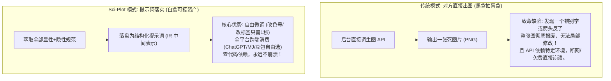
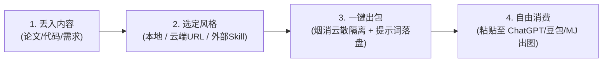
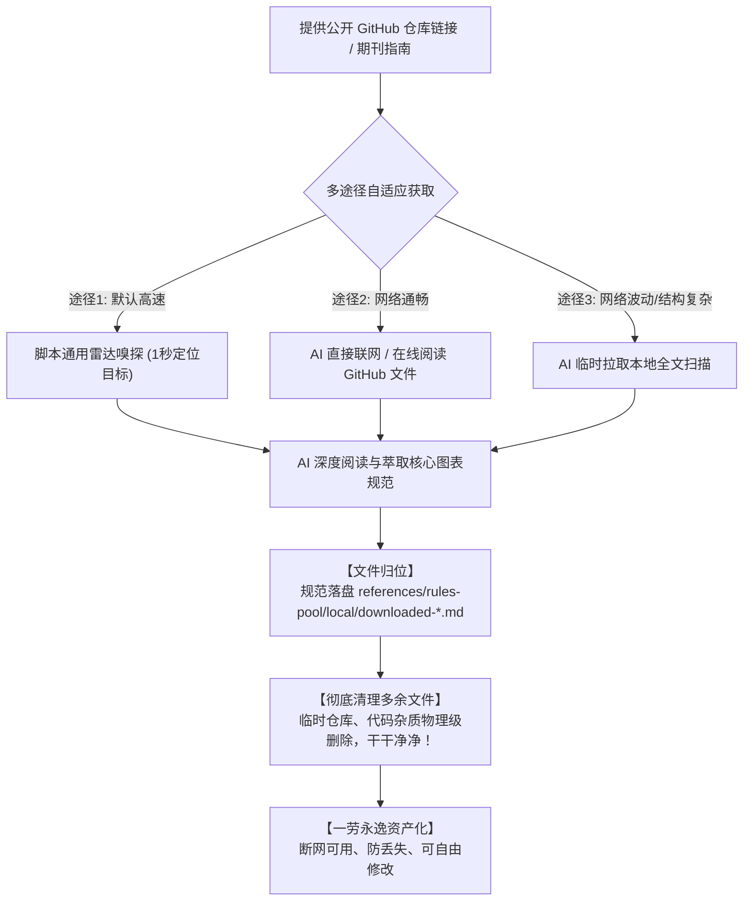
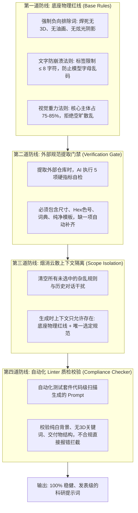

# Sci-Plot — 科研绘图提示词引擎 (Scientific Figure Prompt Engine)

将学术论文、项目代码、算法与技术文档，转化为高规范、高可用、跨平台的 AI 绘图提示词（Prompt）。

---

## 核心设计哲学 (Core Architecture)

### 1. 为什么“只出提示词，绝不直接生图”？
- **解耦环境，杜绝崩溃**：第三方直接生图的工具极度依赖宿主环境、特定 CLI 或 API 凭证，环境稍有不符就直接崩溃报错。Sci-Plot 零环境依赖。
- **中间表示（IR）持久化**：提示词是可持久化、可审计、可人工微调的中间资产。
- **全平台自由消费**：一份提示词不仅可以复制到 **ChatGPT/DALL-E、Midjourney、Stable Diffusion、豆包、通义万相** 等 Web 端快速出图，也可以作为结构指导用于生成 **HTML、SVG、Matplotlib、Origin** 图表。



### 2. 双轨专业规范池 (Dual-Track Rules Pool)
不再把外部所有规范死板硬拷贝到本地，而是采用双轨规范池：
- **📁 本地规范池 (`references/rules-pool/local/`)**：用户最常用的预置经典规范（如 `paper-figure` 顶会风、`journal-minimal` 极简风、`sketchnote` 笔记风）以及用户自定义的 `.md` 规范。
- **🌐 云端/外部规范池 (`references/rules-pool/cloud/`)**：
  - **权威期刊在线指南**（Nature/IEEE/Science 图表标准）；
  - **在线 URL 动态解析**（输入任意网页链接实时抓取图表约束）；
  - **外部生图 Skill 能力借取协议**：**“只借其词（Prompt），绝不调其图（Image API）”**。读取第三方技能的词库与模板，剥离其生图工具调用，无风险复用其领域的顶级绘图能力。

### 3. “烟消云散” 上下文隔离机制 (Scope Isolation)
- 在沟通推荐阶段（Round 3），可以自由比对本地池与云端池；
- **核心红线**：**一旦用户确定了具体的绘图规范，其余所有未选中的规则、外部链接与干扰信息全部“烟消云散”（清出后续上下文）**；
- 第四步生成阶段，大模型仅且只允许加载：
  $$\text{底座物理红线 (base-rules.md)} + \text{唯一选中的专业规范}$$
  从根源上杜绝大模型“规则打架”与上下文污染，确保输出极度纯净、高质量。

---

## 强制标准化工作流 (Mandatory 5-Round Workflow)



### Round 0: 锁定分析目标 (Determine Target)
1. 优先使用用户明确指定的目标（路径 / 链接 / 粘贴文本）；
2. 若未指定，自动扫描当前工作区，优先级：
   - `.tex` 文件（LaTeX 论文，公式、架构、方法最完整）
   - `.md` / `.pdf` 文档
   - `.py` 核心算法代码与数据流；
3. 若无可用内容，主动询问用户提供。

### Round 1: 语义深度分析 (Analyze Content)
参考 `references/analysis-guide.md`，执行四步分析法：
- 论文核心创新点（1~3 个）、方法输入→处理→输出全流程；
- 模块依赖关系与数据流向；
- 核心公式与张量维度（如 $d=512$, $h=8$）；
- 核心实验结论与对比基准（Baselines）。

### Round 2: 提取图解切片 (Extract Visuals)
过滤并决定图解规划：
- **必须图解**：方法全局架构（1 页）、核心机制内部放大（1~2 页）、最强实验数据对比（1 页）；
- **跳过图解**：相关工作背景、简单消融实验、纯文字可表述的内容。

### Round 3: 人机沟通与规范匹配 (Communicate & Match Rules)
向用户确认并推荐以下参数：
1. **画幅与用途**：默认 2:3（论文方法图）或 16:9（幻灯片/展示）；
2. **张数建议**：推荐 1~5 张，并列出每张图的主题；
3. **语言**：英文（默认，生图效果最好） / 中文 / 双语；
4. **规范来源选择 (Rules Source)**：
   - **选项 A（动态本地规范池检索）**：AI **动态扫描检索** `references/rules-pool/local/` 目录下的所有 `.md` 文件（绝不依赖死板的硬编码列表！自动感知 5 款预置规范、用户自建规范、以及以往下载沉淀的 `downloaded-*.md`），将当前可用列表与简要描述动态展示给用户选择（默认推荐 `paper-figure` 顶会风）。
   - **选项 B（云端期刊指南）**：如 Nature, IEEE, Cell, Science 等预置在线标准。
   - **选项 C（在线链接/联网搜索）**：用户直接提供包含图表要求的 URL 或要求联网搜索，AI 实时提炼。
   - **选项 D（99% 典型场景：公开 GitHub Skill 仓库地址）**：用户直接提供任意 GitHub 仓库链接或名称（如 Top 10 榜单仓库）。AI 自动启动通用雷达嗅探算法，准确定位核心规范文档，并自动拦截其生图 API，只借取其 Prompt 模板。

> **⚡【云端/网络核心规范萃取、下载与 AI 强制复查协议】(Materialization & Verification Gate)**：  
> 若用户选用了选项 **B、C 或 D**（云端/网络/GitHub 来源）：  
> 1. **AI 智能感知与双模定位**：AI 可通过脚本雷达高速嗅探，网络好时亦可直接在线语义阅读 GitHub 结构与文档；若网络波动或仓库结构极其复杂，AI 可临时下载至临时区进行本地全文扫描。若规范分散在多个文件（如尺寸在一个文件、配色在另一个文件），AI 自动聚合萃取；若存在多个互不兼容的独立画风（如生物 vs 电路），则分别沉淀为独立子规范。  
> 2. **拒绝原样堆砌，执行标准化改写**：剔除原仓库中一切 `pip install`、API Key、生图代码等环境噪音，将其重构为自洽统一的标准规范 Schema。  
> 3. **落盘至本地规范池并彻底清理多余文件（保持干干净净）**：将萃取后的标准规范保存至 `references/rules-pool/local/downloaded-{source-name}.md`，头部注明来源与开源致敬。**所有中间拉取的临时仓库与多余文件立即彻底删除**，工作区不留任何垃圾，干干净净！  
> 4. **【强制复查检验卡点 (Verification Gate)】**：AI 落盘后**必须立即核验 5 项基准要素**：  
>    - [x] 画布几何与单双栏尺寸约束是否存在？  
>    - [x] 主色与强调色号（Hex）是否明确？  
>    - [x] 领域专业术语映射表是否完备？  
>    - [x] 核心英文 Prompt 模板是否为纯净视觉描述（无 API 残留）？  
>    - [x] 外部生图调用是否已 100% 被拦截剥离？  
>    *若有遗漏，AI 必须基于原仓库内容自动修复补齐，自检通过后方可进入 Round 4！*  
> 5. 提示用户：“*已完成外部规范萃取、下载与 AI 闭环核验，已永久沉淀至本地！*” 随后直接以该规范进入下一步。



### Round 4: 规则锁定与单向生成 (Lock Rule & Generate)



**执行【烟消云散】机制**：其余候选规则全部清空，只加载：
1. `references/core/base-rules.md`（底座物理法则：标签≤8字、色彩≤3种、主体占80%、负向排除3D与杂乱装饰）；
2. **唯一选中的专业规范文档**（本地原生规范，或刚才从云端下载沉淀的规范文件）。

为每页生成结构化 Prompt 文件，保存至 `sci-plot-output/prompts/` 目录。必须严格采用 `base-rules.md` 中规定的标准模版（包含 Metadata、Composition Description、Content Elements、English Prompt 核心可复制段落）。

### Round 5: 交付与消费引导 (Output & Deliver)
生成完整交付目录：
```
sci-plot-output/
├── analysis.md             # 内容深度分析摘要
├── figure-plan.md          # 系列图解总规划
├── prompts/
│   ├── 01-overview.md      # 第 1 页提示词
│   ├── 02-mechanism.md     # 第 2 页提示词
│   └── ...
└── README.md               # 消费指引（如何复制到 ChatGPT/Midjourney/豆包出图，或转为 SVG/Matlab）
```

---

## 独立下游扩展：Prompt ➔ HTML 可选转换插件 (Post-Processing Extension)

> **物理隔离铁律**：`references/renderers/` 目录属于下游后处理插件。**在 Round 0 至 Round 5 的主线执行过程中，大模型严禁提前索引、引用或读取该目录下的任何文件**，以确保生图提示词生成的绝对纯净。

### 触发条件 (On-Demand Trigger)
仅当 Round 5 提示词全部生成并落盘完毕后，且用户**显式要求转换**时（例如：“把生成的提示词转为 HTML”）：
1. 动态加载 [`references/renderers/html/prompt-profile.md`](references/renderers/html/prompt-profile.md) 中的可插拔转换规范与 [`config.json`](references/renderers/html/config.json)；
2. 仅以已落盘的 `sci-plot-output/prompts/*.md` 作为单一输入；
3. 将每张图单向编译为独立的 HTML 交互图表，输出至 `sci-plot-output/html/*.html`。

