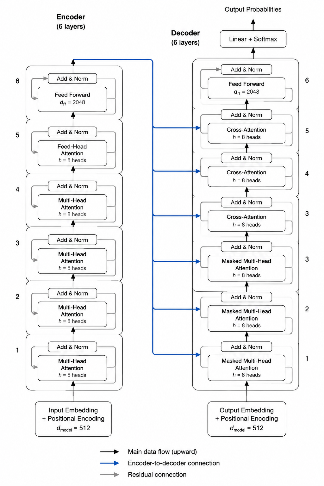
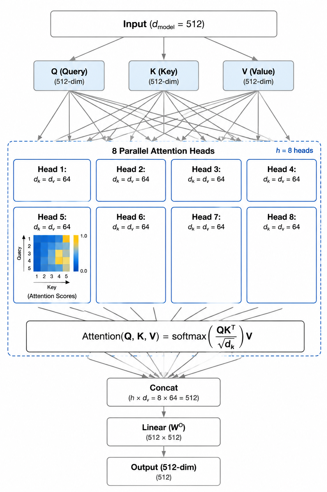
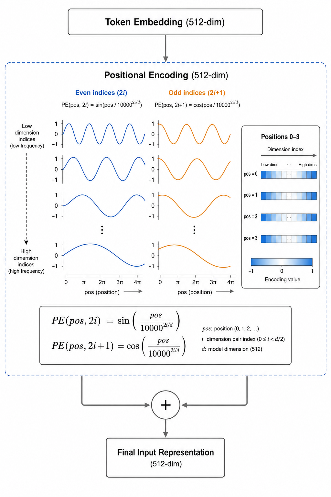

# Example: Transformer Paper ("Attention Is All You Need")

This example demonstrates sci-plot output for the classic Transformer paper (Vaswani et al., 2017).

## What's Included

```
transformer-paper/
├── analysis.md              # Content analysis summary
├── figure-plan.md           # Figure plan (3 figures proposed)
├── prompts/
│   ├── 01-overview.md       # Transformer architecture overview prompt
│   ├── 02-attention-mechanism.md  # Multi-head attention detail prompt
│   └── 03-positional-encoding.md  # Positional encoding prompt
└── README.md                # This file
```

## Rendered Examples

These prompts were rendered with a generative image tool using the `paper-figure` style (clean vector lines, white background, restrained blue accent):

| Figure 1 · Architecture | Figure 2 · Attention | Figure 3 · Positional Encoding |
| :---: | :---: | :---: |
|  |  |  |

> The `.md` prompt files are the durable, editable assets; the PNGs are optional previews.

## How This Was Generated

**User input**:
```
Follow /sci-plot/SKILL.md to generate prompts.
Target: Transformer paper (Attention Is All You Need, 2017)
```

**AI workflow**:
1. ✅ **Round 0**: Target determined (Transformer paper)
2. ✅ **Round 1**: Analyzed paper content (read `analysis-guide.md`)
3. ✅ **Round 2**: Extracted illustratable content (architecture, attention, positional encoding)
4. ✅ **Round 3**: Confirmed with user:
   - Language: English
   - Style: paper-figure
   - Count: 3 figures
   - Aspect ratio: 2:3 (portrait)
   - Purpose: Technical blog / README
5. ✅ **Round 4**: Generated prompts (read `prompt-rules.md` + `paper-figure.md`)
6. ✅ **Round 5**: Output to `prompts/` directory

## How to Use These Prompts

### Step 1: Open a Prompt File
Open `prompts/01-overview.md` in any text editor.

### Step 2: Copy the English Prompt Section
Find the section marked `▶ English Prompt (Core — Copy Directly)` and copy the entire block.

### Step 3: Paste into Image Generation Tool
**ChatGPT (recommended)**:
1. Open ChatGPT with DALL-E access
2. Paste the prompt
3. Wait 10-30 seconds for generation

**Doubao / Qwen / Midjourney**:
Follow the same process — paste the prompt into the text-to-image entry.

### Step 4: Iterate if Needed
If the output doesn't match expectations:
- Try a different tool (each has different strengths)
- Add specific adjustments to the prompt (e.g., "make arrows thicker")
- Regenerate with the same prompt (randomness may help)

## Expected Output Quality

**Good for**:
- README hero images
- Technical blog illustrations
- Presentation slides
- Paper supplementary materials

**Not suitable for**:
- Camera-ready paper figures (require vector editing)
- Highly precise mathematical diagrams (use TikZ instead)
- Figures requiring exact dimensions

## Customization

Want different styles? Edit `figure-plan.md` to change:
- **Style**: `sketchnote` for warm hand-drawn look
- **Language**: `zh` for Chinese, `bilingual` for both
- **Aspect ratio**: `16:9` for landscape slides
- **Count**: Add a 4th figure for positional encoding detail

Then re-run sci-plot with the updated plan.

## Notes

- This example uses **paper-figure** style (clean, professional, vector-feel)
- Prompts are ~500 words each (detailed enough for good results)
- All prompts follow the mandatory template in `references/prompt-rules.md`
- Cross-platform compatible: works in ChatGPT, Doubao, Qwen, Midjourney, etc.
