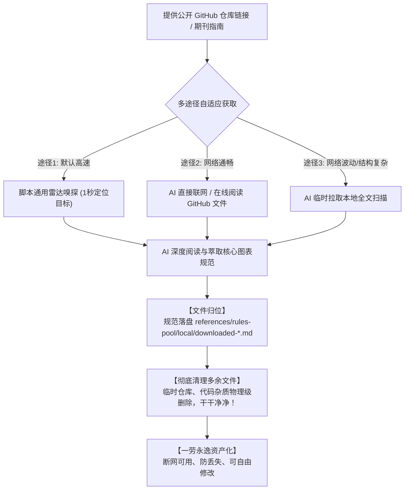

# 云端与外部规范池索引与下载协议 (Cloud & External Rules Channels & Downloader)

本目录为 `sci-plot` 的**云端/外部规范池（Cloud Pool）**。它不只提供轻量级索引，更提供了强大的**“云端核心规范萃取与本地持久化下载（Cloud-to-Local Materialization）”**协议。

用户通过联网搜索、在线网页 URL 或外部开源生图 Skills 获取的优质规则，**均可被自动解析、提炼并下载落盘至本地规范池 (`references/rules-pool/local/`)**，实现一次抓取、永久离线复用、可二次自由编辑！

---

## 一、 预置权威学术期刊图表在线规范通道

当用户指定对应期刊投稿需求或输入对应链接时，AI 依据官方规范提炼参数，并支持一键下载至本地规范池：

| 机构 / 期刊 | 官方规范要点摘要 | 推荐基准参数 | 推荐本地文件名 |
| :--- | :--- | :--- | :--- |
| **Nature 系列 (Nature Portfolio)** | 单栏宽度 89 mm，双栏 183 mm；字体 Helvetica / Arial；无底色（纯白）；避免复杂 3D 渐变 | `white bg, vector line-art, 89mm single column, Helvetica labels, restrained nature-blue accent` | `downloaded-nature.md` |
| **IEEE Transactions** | 单栏 3.5 英寸 (88.9 mm)，双栏 7.16 英寸 (182 mm)；字体 Times / Helvetica；高对比度灰度友好 | `ieee publication style, crisp line weights, 88mm column width, high contrast vector blocks` | `downloaded-ieee.md` |
| **Cell / Elsevier** | 强调机制逻辑流（Graphical Abstract / In Brief）；模块圆角统一；色彩柔和区分细胞与蛋白亚基 | `cell graphical abstract style, soft pastel palette, clear ligand-receptor pathways, flat vector` | `downloaded-cell.md` |
| **Science (AAAS)** | 极简、高密度数据呈现；无边框、无多余阴影；主色调冷色系 | `science journal figure, minimalist, clean sans-serif typography, zero decorative elements` | `downloaded-science.md` |

---

## 二、 在线 URL / 联网搜索规范萃取与【下载到本地】协议

当用户提供一个网页链接（如期刊 Author Guidelines、技术博客、绘图专栏）或要求联网搜索某种新绘图要求时：

### 核心步骤：
1. **联网检索与阅读**：AI 使用联网搜索或网页抓取工具读取目标网页正文；
2. **5 大核心规范要素提炼**：
   - **元数据**：来源网址、期刊/团队名称、抓取日期；
   - **版面几何约束**：画布纵横比、单双栏尺寸（mm/inch）、留白比例；
   - **色彩与线条**：限定主色与强调色号（Hex）、背景要求（纯白/透明）、主辅线条像素粗细；
   - **字体与文字密度**：推荐字体（Helvetica/Arial/Times）、标签字数上限；
   - **专属 Prompt Snippet**：提炼出一段最地道、最契合该网页要求的核心英文提示词片段。
3. **【核心动作：下载并沉淀至本地】**：
   - 自动在本地规范池目录生成文件：
     `references/rules-pool/local/downloaded-{channel-or-journal}.md`
   - **收益**：**一次下载，永久沉淀！** 下次直接离线调用，再也不怕网页失效、断网或重复检索，用户还可随时手动打开该文件修改。

---

## 三、 外部 Skills 能力借取与【词典/提示词下载】协议

> **核心哲学**：外部生图 Skill 强依赖特定本地环境和 API，我们**“只借其词（Prompt），绝不调其图（Image API），并将其实体词典与 Prompt 模板完整下载落盘”**！



当用户指定借用某个外部第三方绘图 Skill（例如生物信号通路 Skill、电气原理图 Skill）时：

### 执行规则：
1. **扫描外部 Skill**：AI 找到其技能主文件（如 `SKILL.md`、Python 模板或提示词工程库）；
2. **核心能力萃取**：
   - 提取其专有的**领域专业英文术语映射表**（Domain Terminology Dictionary）；
   - 提取其经过大量调试验证的**最佳生图提示词结构（Prompt Pattern）**；
   - 拦截并彻底剥离其内部的生图 API 调用（`generate_image`, `render_png` 等）；
3. **【核心动作：本地固化下载】**：
   - 将提取出的领域词典与绘图 Prompt 模板，组装为独立的本地规则文件：
     `references/rules-pool/local/downloaded-skill-{skill-name}.md`
   - 提示用户：*“已成功将外部 Skill [{skill-name}] 的绘图规范与领域词典下载并沉淀至本地规范池！”*
4. **即刻使用**：直接作为当前任务的选定规则，执行【烟消云散】后单向生成，全程零环境报错。

---

## 四、 本地下载规范的标准文件模版 (Downloaded Rule Schema)

下载落盘至 `references/rules-pool/local/` 的文件统一遵循以下标准格式：

```markdown
# [规则名称] — 规范定义 (Downloaded Rule)

> **来源**: [在线链接 / 外部 Skill 名称]  
> **下载归档时间**: [YYYY-MM-DD]  
> **状态**: 本地已固化（支持二次编辑）

## 1. 风格定位与视觉特征
- [视觉质感描述]

## 2. 画布与排版约束
- **背景**: 纯白 (#FFFFFF)
- **推荐比例**: 2:3 (方法图) / 16:9 (展示)
- **线框规范**: 核心流 2-3px, 辅助线 1px

## 3. 色彩限制 (≤3色)
- 主色: [Hex]
- 强调色: [Hex]

## 4. 专属领域词典 (Domain Vocabulary)
- [术语 A]: [对应生图视觉描述]
- [术语 B]: [对应生图视觉描述]

## 5. 核心英文提示词片段 (Prompt Snippet)
```text
[一段提炼出、可直接复用的核心视觉提示词]
```
```

---

## 五、 科研绘图 Skill Top 10 官方集录通道 (Top 10 Open-Source Scientific Figure Skills)

根据全球权威排行的「科研绘图 Skill Top 10」榜单（按 GitHub 仓库总星标数排序），本引擎提供全量官方云端通道集录与雷达自适应下载支持。AI 可随时借取其专有绘图能力并自动沉淀至本地：

| 排名 | 项目名称与仓库地址 | 核心专长与学科领域 | 雷达自动嗅探文件 | 本地沉淀文件名 |
| :---: | :--- | :--- | :--- | :--- |
| **1** | **Academic Research Skills**<br>[Imbad0202/academic-research-skills](https://github.com/Imbad0202/academic-research-skills) | **全流程学术研究与同行评审图表**<br>论文架构推演、APA 7.0 图表标准、对称双栏对比 | `academic-paper/references/statistical_visualization_standards.md` | `downloaded-academic-research-skills.md` |
| **2** | **Nature-skills**<br>[Yuan1z0825/nature-skills](https://github.com/Yuan1z0825/nature-skills) | **Nature 顶级期刊图表与排版标准**<br>单双栏尺寸 (89mm/183mm)、Arial/Helvetica、正交走线 | `skills/nature-figure/references/vector-schematic-style-rules.md` | `downloaded-nature-skills.md` |
| **3** | **Scientific Agent Skills**<br>[K-Dense-AI/scientific-agent-skills](https://github.com/K-Dense-AI/scientific-agent-skills) | **170+ 跨学科 AI 科学家科研技能库**<br>生物医药、分子对接、数据管道卡片、高信息密度 | `skills/scientific-schematics/references/best_practices.md` | `downloaded-scientific-agent-skills.md` |
| **4** | **Auto-claude-code-research-in-sleep**<br>[wanshuiyin/Auto-claude-code-research-in-sleep](https://github.com/wanshuiyin/Auto-claude-code-research-in-sleep) | **长程自主科研推理与数学证明流**<br>自动化科研推演循环图、证明调度流、多阶段状态机 | `skills/proof-orchestrator/references/dispatch-prompts.md` | `downloaded-auto-claude-code-research-in-sleep.md` |
| **5** | **AutoResearchClaw**<br>[aiming-lab/AutoResearchClaw](https://github.com/aiming-lab/AutoResearchClaw) | **自动化科研探索与数据可视化**<br>学术实验数据可视化流水线、多模态科学报告配图 | `.claude/skills/scientific-visualization/SKILL.md` | `downloaded-autoresearchclaw.md` |
| **6** | **GPT-Image2-Skill**<br>[wuyoscar/GPT-Image2-Skill](https://github.com/wuyoscar/GPT-Image2-Skill) | **现代 AI 生图提示词工程与画廊规范**<br>高精度图像生成提示词参数模板、数据图表美学调优 | `skills/gpt-image/references/gallery-data-visualization.md` | `downloaded-gpt-image2-skill.md` |
| **7** | **MathModelAgent**<br>[jihe520/MathModelAgent](https://github.com/jihe520/MathModelAgent) | **数学建模竞赛与工程算法可视化**<br>数学模型机理图、三维拓扑切片、算法流程卡片 | `skills/mathmodel-figure-templates/references/plot-recipes.md` | `downloaded-mathmodelagent.md` |
| **8** | **Figures4papers**<br>[ChenLiu-1996/figures4papers](https://github.com/ChenLiu-1996/figures4papers) | **论文专用科研配图与插图 API**<br>SCI 论文插图布局、实验曲线对比图、模块组合图 | `scientific-figure-making/references/api.md` | `downloaded-figures4papers.md` |
| **9** | **codex-claude-academic-skills**<br>[zLanqing/codex-claude-academic-skills](https://github.com/zLanqing/codex-claude-academic-skills) | **跨助手学术写作与科学工具链**<br>学术插图调优、期刊图表代码配图与数据渲染规范 | `scientific-toolkit-skill/.../matplotlib_examples.md` | `downloaded-codex-claude-academic-skills.md` |
| **10** | **AcademicForge**<br>[HughYau/AcademicForge](https://github.com/HughYau/AcademicForge) | **学术科研锻造工坊与可视化模板**<br>模块化学术插图设计、数据图表配色与矢量输出规范 | `skills/scientific-visualization/references/matplotlib_examples.md` | `downloaded-academicforge.md` |
