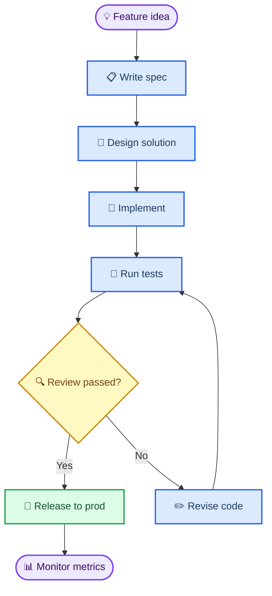
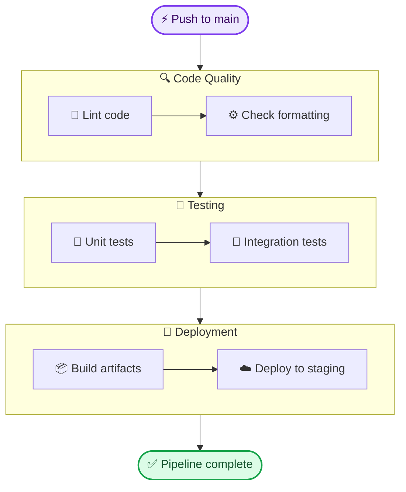
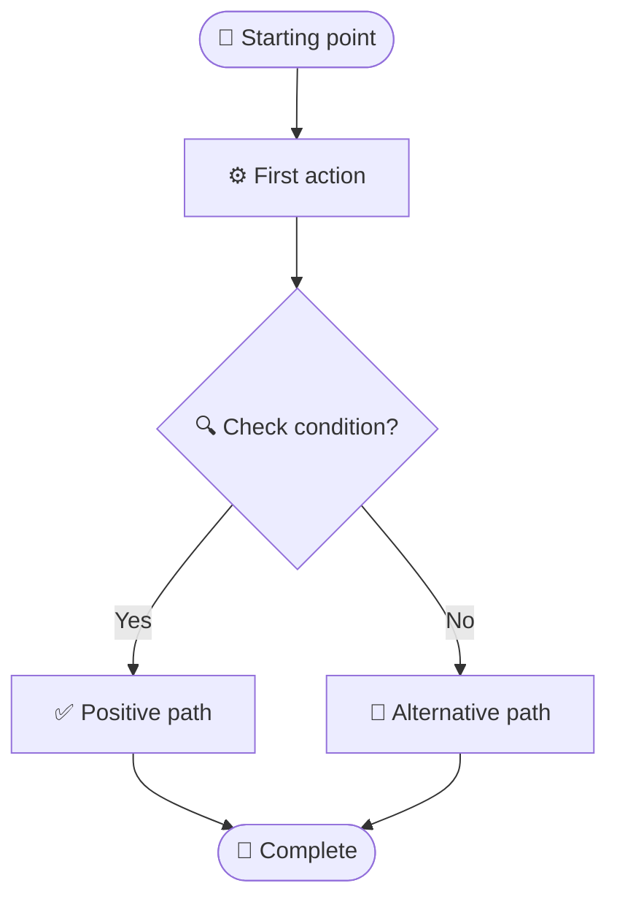

# SCIENTIFIC-AGENT-SKILLS — 智能自适应下载绘图规范 (Downloaded Rule)

> **官方来源仓库**: https://github.com/K-Dense-AI/scientific-agent-skills  
> **雷达自动嗅探路径**: `skills/markdown-mermaid-writing/references/diagrams/flowchart.md` (源文件大小: 7036 字节)  
> **抓取机制**: 通用仓库递归雷达扫描与自适应定位 (Universal Radar Discovery)  
> **状态**: 本地已固化（永久离线可用，支持二次编辑）

---

## 1. 风格定位与视觉特征
- **来源项目**: K-Dense-AI/scientific-agent-skills
- **发现核心组件**: 自动嗅探自 `skills/markdown-mermaid-writing/references/diagrams/flowchart.md`，专精于科研图表与学术流程图的规范化构建。

---

## 2. 画布与排版约束
- **背景**: 纯白 (#FFFFFF) 或 浅冷灰 (#F8FAFC)
- **排版比例**: 2:3 (方法机制图) / 16:9 (全景流程图)
- **线框规范**: 核心流加粗 1.5-2px，辅助线 0.75-1px，结构连接一律正交走线，箭头清晰。

---

## 3. 色彩限制 (≤3色)
- **主结构线框**: 深色墨水墨线 (#1A1A1A / #334155)
- **唯一强调色**: 依据领域选取 1 种强调色（如科技蓝 #0284C7 或 #2563EB）高亮核心创新点
- **背景填充**: 浅灰/纯白底色，严禁杂乱渐变

---

## 4. 专属领域词典 (Domain Vocabulary)
- `Source Context`: Discovered from `skills/markdown-mermaid-writing/references/diagrams/flowchart.md`
- `Key Concepts`: Extracted from authentic repository guidelines

---

## 5. 核心英文提示词片段 (Prompt Snippet)
```text
Scientific vector schematic in scientific-agent-skills style, pure white background, flat 2D layout. Precise line weights, restrained theme accent, clean sans-serif typography, crisp directional connectors, no 3D effects, no drop shadows, no glossy textures.
```

---

## 附录：嗅探到的原始规范节选 (Source Excerpt)
```markdown
<!-- Source: https://github.com/SuperiorByteWorks-LLC/agent-project | License: Apache-2.0 | Author: Clayton Young / Superior Byte Works, LLC (Boreal Bytes) -->

# Flowchart

> **Back to [Style Guide](../mermaid_style_guide.md)** — Read the style guide first for emoji, color, and accessibility rules.

**Syntax keyword:** `flowchart`
**Best for:** Sequential processes, workflows, decision logic, troubleshooting trees
**When NOT to use:** Complex timing between actors (use [Sequence](sequence.md)), state machines (use [State](state.md))

---

## Exemplar Diagram



---

## Tips

- Use `TB` (top-to-bottom) for processes, `LR` (left-to-right) for pipelines
- Rounded rectangles `([text])` for start/end, diamonds `{text}` for decisions
- Max 10 nodes — split larger flows into "Phase 1" / "Phase 2" diagrams
- Max 3 decision points per diagram
- Edge labels should be 1–4 words: `-->|Yes|`, `-->|All green|`
- Use `classDef` for **semantic** coloring — decisions in amber, success in green, actions in blue

## Subgraph Pattern

When you need grouped stages:



---

## Template



---

## Complex Example

A 20+ node e-commerce order pipeline organized into 5 subgraphs, each representing a processing phase. Subgraphs connect through internal nodes, decision points route orders to exception handling, and color classes distinguish phases at a glance.

```mermaid
flowchart TB
    accTitle: E-Commerce Order Processing Pipeline
    accDescr: Full order lifecycle from intake through fulfillment, shipping, and notification with exception handling paths for payment failures, stockouts, and delivery issues

    order_in([📥 New order]) --> validate_pay{💰 Payment valid?}

    subgraph intake ["📥 Order Intake"]
        validate_pay -->|Yes| check_fraud{🔐 Fraud check}
        validate_pay -->|No| pay_fail[❌ Payment declined]
        check_fraud -->|Clear| check_stock{📦 In stock?}
```
